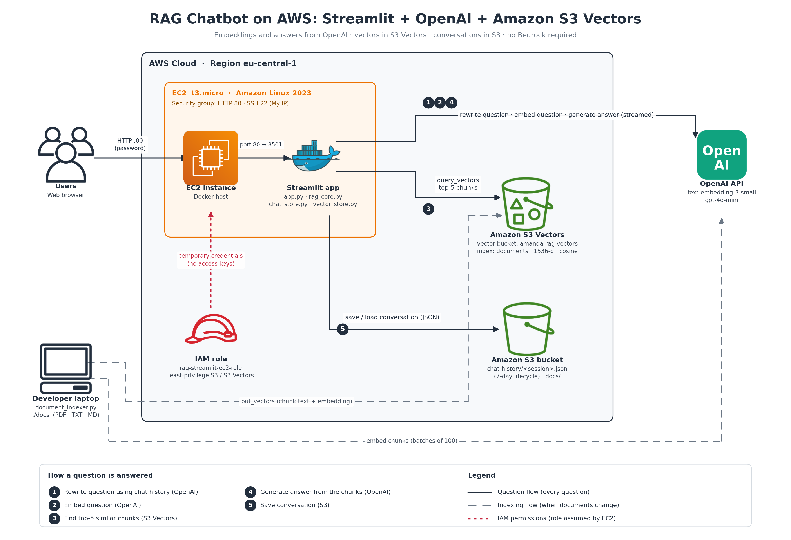

# RAG Chatbot on AWS: Streamlit + OpenAI + Amazon S3 Vectors

A conversational **Retrieval-Augmented Generation (RAG)** chatbot that answers questions about your own documents.

- **Front end:** Streamlit, running in Docker on **Amazon EC2**
- **Embeddings and answers:** **OpenAI** (`text-embedding-3-small`, `gpt-4o-mini`), so Amazon Bedrock is not required
- **Vector database:** **Amazon S3 Vectors**
- **Chat history and source documents:** **Amazon S3**



## How it works

**Indexing** (`document_indexer.py`, run when documents change)
1. Read PDF/TXT/MD files from `s3://<bucket>/docs/`.
2. Split them into ~800-character chunks with overlap.
3. Embed the chunks with OpenAI (batches of 100).
4. Store vectors + chunk text in the S3 Vectors index (full re-index on every run).

**Answering** (`app.py`, every question)
1. **Rewrite** the question into a standalone query using the recent chat history.
2. **Embed** the rewritten query with the same OpenAI model.
3. **Retrieve** the 5 most similar chunks from S3 Vectors (cosine distance).
4. **Generate** the answer with OpenAI using only those chunks, streamed to the UI with sources.
5. **Save** the conversation as JSON in `s3://<bucket>/chat-history/` (auto-deleted after 7 days).

## Repository structure

| File | Purpose |
|---|---|
| `app.py` | Streamlit UI: chat, sessions, sources, debug view |
| `rag_core.py` | Query rewriting, retrieval and answer generation (OpenAI) |
| `vector_store.py` | Amazon S3 Vectors: create index, put, query, list |
| `chat_store.py` | Conversation history in S3 |
| `document_indexer.py` | Parse → chunk → embed → index |
| `config.py` | Settings loaded from environment variables / `.env` |
| `requirements.txt` | Python dependencies |
| `Dockerfile` | Container image definition |
| `.env.example` | Template for the `.env` file (never commit the real `.env`) |
| `infra/` | IAM policy templates, S3 lifecycle rule, EC2 helper scripts |

## AWS resources (region `eu-central-1`)

| Resource | Name | Notes |
|---|---|---|
| S3 bucket (general purpose) | `aim-rag-chatbot-data-2026` | Folders `chat-history/` and `docs/`; lifecycle rule expires `chat-history/` after 7 days |
| S3 vector bucket | `aim-rag-vectors` | Index `documents`: dimension **1536**, distance **cosine**, non-filterable metadata key **`content`** |
| IAM role | `rag-streamlit-ec2-role` | Trusted entity: EC2. Inline policy from `infra/ec2-s3-policy.template.json` |
| EC2 instance | `rag-streamlit` | Amazon Linux 2023, t3.micro, IAM role attached, metadata hop limit 2 |
| Security group | `rag-streamlit-sg` | HTTP 80 (My IP or Anywhere), SSH 22 from the EC2 Instance Connect prefix list |

No AWS access keys are stored anywhere: the app gets temporary credentials from the EC2 IAM role.

## Deploy on EC2

Connect with **EC2 → Instance → Connect → EC2 Instance Connect**, then:

```bash
# 1. Get the code
git clone https://github.com/<USER>/<REPO>.git
cd <REPO>

# 2. Configure
cp .env.example .env
nano .env            # set OPENAI_API_KEY (and check bucket names / region)
chmod 600 .env

# 3. Build and run
sudo docker build -t rag-streamlit .
sudo docker run -d --name rag-streamlit --restart unless-stopped --env-file .env -p 80:8501 rag-streamlit

# 4. Index the documents in s3://<bucket>/docs/
sudo docker exec -it rag-streamlit python document_indexer.py
```

Open `http://<EC2-public-IP>` in your browser.

**Update after code changes:** `git pull && ./infra/run-on-ec2.sh`

## Run locally (optional)

Requires Python 3.11+ and AWS credentials configured with `aws configure`.

```bash
python -m venv .venv && source .venv/bin/activate     # Windows: .venv\Scripts\activate
pip install -r requirements.txt
cp .env.example .env                                   # fill in OPENAI_API_KEY
python document_indexer.py
streamlit run app.py
```

## Configuration (`.env`)

| Variable | Default | Description |
|---|---|---|
| `OPENAI_API_KEY` | n/a | OpenAI API key |
| `EMBEDDING_MODEL` / `EMBEDDING_DIM` | `text-embedding-3-small` / `1536` | Must match the index dimension |
| `LLM_MODEL` | `gpt-4o-mini` | Chat model for rewriting and answering |
| `AWS_REGION` | `eu-central-1` | Region of both buckets |
| `VECTOR_BUCKET` / `VECTOR_INDEX` | `aim-rag-vectors` / `documents` | S3 Vectors location |
| `S3_BUCKET` | `aim-rag-chatbot-data-2026` | Bucket for chat history and documents |
| `S3_HISTORY_PREFIX` / `S3_DOCS_PREFIX` | `chat-history/` / `docs/` | Folders inside the bucket |
| `APP_PASSWORD` | empty | Optional login password (empty = no login) |
| `TOP_K` / `MAX_DISTANCE` / `HISTORY_TURNS` | `5` / `0.9` / `4` | Retrieval and memory settings |

## Security notes
- `.env` is excluded from Git (`.gitignore`) and from the Docker image (`.dockerignore`).
- The IAM role only allows `chat-history/*` (read/write), `docs/*` (read) and the one vector bucket.
- The S3 bucket blocks all public access and is encrypted (SSE-S3).
- For a public deployment, add HTTPS (e.g. Caddy with a domain) and set a budget in your OpenAI project.

## Cost (approximate, small project)
EC2 t3.micro + public IPv4 + 8 GB disk ≈ $12/month (stop the instance when not in use). S3 and S3 Vectors cost cents at this scale. OpenAI usage is billed separately.
